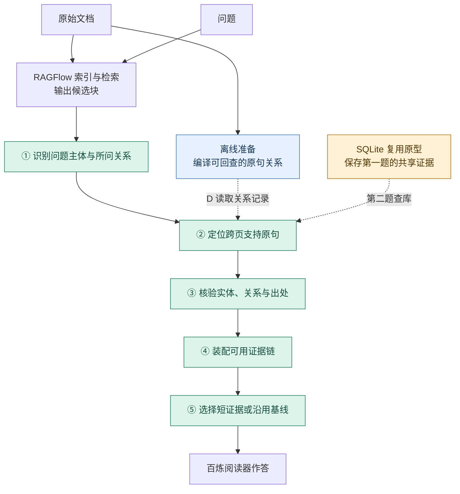

# 多跳问答证据压缩组件与实验结果

**2026 年 11 月 15 日｜RAGFlow A/B/C/D 对照｜100 道开发题**

在同一份原生 Wiki 检索结果上，加入在线组件后，**总在线 token 从 193,083 降到 186,125，减少 6,958（3.60%）**。F1 从 **63.23% 升至 63.73%**，EM 从 **51% 升至 52%**。收益来自实际缩短的 5 道题，其中 1 道改对。在此基础上接入离线原句关系的 D，逐题结果与 C 相同。相对纯原文 RAG 的 A，C/D 总 token 仍多 269 个。

## 1. 组件在问答流程中的位置

组件接收问题和已检索到的材料，在百炼阅读器作答之前，找出能连成推理链的原句，决定该发这些原句还是沿用基线材料。离线编译提前准备可回查的关系记录。SQLite 支线另测同一事实能否被后续问题复用。

### 1.1 离线准备 · 编译带原句出处的关系

**应用阶段。** 文档入库或实验准备阶段，在问题到达前执行。原生 RAGFlow 使用自己的 Wiki 编译流程组织页面。本项目额外从同一原文生成句级关系记录，为 D 的在线选证提供来源线索。

**具体操作。** 编译器把标题和编号原句交给百炼，抽取主体、关系、客体三元组，例如 `Tysons Galleria → 位于 → McLean, Virginia`。同时保存文档 ID、来源版本、支持句编号、字符起止位置和逐字原句。若事实句使用代词，还需记录能绑定主体的原句。程序核对对象文本、主体绑定、关系线索和出处，再保存通过校验的记录。

**本轮接入。** D 复用已编译事实，通过原生 Wiki 块的来源文档 ID 建立关联，并再次按版本和逐字原句校验。在线命中原生 Wiki 块时可读取与其来源文档关联的记录。一条记录能定位来源原句，Wiki 正文是否包含或支持该事实仍需回查。本轮在独立实验目录完成这层集成，使用外置出处索引，原生服务和数据库未写入。

**预期目标。** 将部分事实抽取和出处定位移到查询之前，让查询时能较低成本地找回正确的中间实体及支持句。预期收益要用 D 对 C 验证。[编译校验代码](wiki_compile_v2.py) · [D 的出处索引](results/wiki-evidence-index.jsonl)

### 1.2 五项在线功能

| 功能 | 应用阶段 | 具体操作 | 预期目标 |
| --- | --- | --- | --- |
| **① 识别主体与所问关系** | 检索完成后，选证开始时 | 用有限的英文模式判断题目要的是所在地、别名、成员或首播日期等属性，再用候选标题定位题目明确提到的实体。标题规范化处理部分标点和变体。 | 给选证明确的起点和终点，降低找错实体或属性的风险。 |
| **② 定位跨页支持原句** | 实体和目标确定后 | 从候选中找从起点通往中间实体的原句，再找另一页支持最终关系的原句。C 直接从原文定位，D 在同样的原文搜索上加入已校验编译关系。 | 减少漏掉决定答案的那一跳，为后续删去无关材料创造条件。 |
| **③ 核验关系与出处** | 证据装配前 | 检查两步是否指向同一中间实体，排除明确的地点或版本冲突。候选范围之外的原句不得进入证据链，D 额外核对记录的版本和原句文本。 | 降低同名实体错连、过期记录误用与无出处事实混入的风险。 |
| **④ 装配证据链** | 调用阅读器前 | 以原文中的页面标题和原句呈现核验通过的证据，保留必要前件。此次实验直接装配核验通过的原句集合，按实际长度计量。 | 缩短模型输入，同时让百炼看到完整推理所需的材料。 |
| **⑤ 作答前选路** | 发出百炼请求前 | 只有存在唯一可核验的链，且装出的文本比 B 更短，才走短证据。找不到、存在歧义或无长度收益时直接沿用 B。 | 让不适合压缩的题使用基线材料。每个通道每题只进行一次逻辑答题调用。 |

以 Kimbrough 球场题为例，组件识别出目标是县名，从原文找到「球场位于 Canyon, Texas」和「Canyon 是 Randall County 的县治」，核验两句中的 Canyon 后，把两步一起交给阅读器。在线的定位与核验由本地代码完成。[原文关系定位](raw_relation_locator.py) · [本轮装包与选路](run_abcd.py)

### 1.3 独立原型 · SQLite 跨题证据复用

**应用阶段。** 第一题完成选证后写入，第二道相关题取得自己的候选后、重排或装包前读取。

**具体操作。** 第一题先正常重排并选证，把可共享原句及版本、句序和检索线索写入 SQLite。第二题查询与当前候选同版本的记录，再检查线索是否相符。命中的句子可被优先保留，或从本轮重排输入中排除。原型还保留题面完全相同的精确缓存对照。

**预期目标与已有结果。** 目标是让共享中间事实的不同问题少做一次实际处理。五题小试中 5/5 命中，只减少 **360 个重排输入 token（1.12%）**，重排次数仍为 5。后续 12 道相关新题都有同版本记录，0/12 通过自动短路。两次小试均未建立端到端加速证据。11 月 15 日四组问答未运行此复用原型。[五题小试](../topic2/reports/同作者桥接验证与证据视图小试.md) · [自动复用实验](../topic2/reports/自动证据视图短路保留题实验.md)

## 2. 11 月 15 日实验设置

### 数据、检索与模型

- **样本。** HotpotQA distractor、MuSiQue-Ans 官方开发集各 50 道，均为既有开发样本。问题和原文候选已冻结，官方答案及支持标注用于评分和事后核查。
- **检索。** RAGFlow v1.0.0 的最终索引使用关键词与向量混合检索。每道题有固定可访问文档范围，快照保存检索及出处过滤后最多 20 个有序块。原服务当时停止，本轮复用这份真实快照；A 使用只搜原文的结果，B、C、D 使用同一份含原生 Wiki 的结果。答题响应全部重新生成。
- **阅读器。** 各组使用百炼 `qwen3.5-plus-2026-04-20`，提示一致，temperature 为 0，关闭 thinking，生成上限 128 token。同题同阅读文本共享本次回答。100 题 × 4 组共 400 条评分，分别用两个数据集的官方评分方法复核。
- **证据长度。** 取消 512、1,024 等人为短包限制，A、B 也取消此前的 2,560 证据上限，按顺序使用全部快照块。C、D 仅在证据链唯一且材料比 B 短时换包。A/B 最长证据文本为 3,460 个分词器 token。

### 四组及比较目的

| 通道 | 使用的检索结果 | 阅读器收到的材料 | 比较目的 |
| --- | --- | --- | --- |
| A 原文 RAG | 关闭原生 Wiki 的 RAGFlow 快照 | 快照原文块 | 普通原文 RAG 参照 |
| B 原生 Wiki＋RAG | 开启原生 Wiki 的 RAGFlow 快照 | 快照中的原文和 Wiki 块 | 组件的直接基线 |
| **C 原生 Wiki＋RAG＋在线组件** | **复用 B** | 纯原文关系定位产生的短证据，或 B 的材料 | **C 对 B 衡量在线组件的增量** |
| **D 原生 Wiki＋原句关系＋同一组件** | **复用 B** | 启用句级编译关系后的短证据，或 B 的材料 | **D 对 C 衡量离线关系的额外作用** |

C/D 对已返回原文块有相同的读权限，也都可以沿命中 Wiki 块的出处读取对应候选原文。D 多使用原句关系记录，检索排名保持一致。[实验入口](run_abcd.py) · [冻结配置](results/config.json) · [检索快照](data/native-full-retrieval.jsonl)

## 3. 成绩总表

| 通道 | F1 | EM | 支持触达／严格完整 | 实际缩短题数 | 阅读输入 | 阅读输出 | 检索输入（归档） | 总在线 token |
| --- | ---: | ---: | ---: | ---: | ---: | ---: | ---: | ---: |
| A 原文 RAG | 63.23% | 51% | 93／93 | — | 183,262 | 556 | 2,038 | 185,856 |
| B 原生 Wiki＋RAG | 63.23% | 51% | 93／93 | — | 190,496 | 549 | 2,038 | 193,083 |
| **C 原生 Wiki＋RAG＋在线组件** | **63.73%** | **52%** | 93／90 | **5** | **183,538** | 549 | 2,038 | **186,125** |
| **D 原生 Wiki＋原句关系＋同一组件** | **63.73%** | **52%** | 93／90 | **5** | **183,538** | 549 | 2,038 | **186,125** |

F1 衡量答案与参考答案的词项重合，EM 是官方规则下的精确匹配。证据指标以题计。HotpotQA 两项都要求保留全部官方支持句；MuSiQue 的**触达**要求每个官方支持段至少有一句入包，**严格完整**要求保留完整段落。

**总在线 token = 阅读输入 + 阅读输出 + 查询向量输入。** 每组 2,038 个查询向量 token 来自原快照的 200 次 A/B 查询向量输入 4,076 的平均分摊。当前读取消耗由百炼实测，离线编译另计。每组逻辑答题调用 100 次，整场实验共享相同输入后实际完成 159 次请求，4 次 HTTP 429 均重试成功。部署端到端延迟未实测。[汇总](results/summary.json) · [逐题评分](results/scored.jsonl)

### 分数据集对照

每个数据集 50 道。表中为实际阅读输入，查询向量只在总表按组核算。

| 数据集 | 通道 | F1 | EM | 阅读输入 | 官方支持触达／严格完整 |
| --- | --- | ---: | ---: | ---: | ---: |
| HotpotQA | A | 73.46% | 66% | 70,162 | 49／49 |
| HotpotQA | B | 73.46% | 66% | 76,537 | 49／49 |
| HotpotQA | **C 与 D** | **73.46%** | **66%** | **73,648** | 49／49 |
| MuSiQue | A | 53.00% | 36% | 113,100 | 44／44 |
| MuSiQue | B | 53.00% | 36% | 113,959 | 44／44 |
| MuSiQue | **C 与 D** | **54.00%** | **38%** | **109,890** | 44／41 |

### 结果分析

**C 对 B：确认本批题降本，质量改善集中在一题。** 总在线 token 减少 **6,958（3.60%）**，两个组的阅读输出恰好相同，因此节省全部来自阅读输入。两组各 100 次逻辑答题。5 道题换成了短证据，1 道由部分匹配变为精确匹配，0 道 F1 下降；95 道沿用 B。F1 增加 **0.50 个百分点**，按题配对重采样的 95% 区间为 **[0.00，+1.50] 个百分点**。区间下界为零，尚不足以确认稳定的准确率提升。支持触达保持 93 题，严格完整少 3 题，均因 MuSiQue 短包剪去了参考段内的其他句子。[逐题得分](results/scored.jsonl)

**D 对 C：本轮未观察到增量。** 100 道题的阅读材料、回答和用量逐题相同。离线索引追溯到 100 个不同的命中 Wiki 块，56 个块挂有校验通过的关系，共 60 组块与来源文档绑定。29 道题可读到关联记录，但没有形成额外可放行的证据链。两组未缩短的 95 题中，77 道超出现有关系识别范围，6 道无法定位唯一主体，12 道未形成可核验链。D 还受 Wiki 检索命中限制，漏召回的 Wiki 块无法触发关系查找。[请求和路由记录](results/requests.jsonl) · [出处索引](results/wiki-evidence-index.jsonl)

**C/D 对 A：接近原文成本，仍多 269 token（0.14%）。** 原生 Wiki 的 B 在本批题比 A 多 7,227 个总在线 token，F1 和 EM 同分。组件省掉其中 6,958 个 token。当前实证范围是这批既有开发题与固定检索快照；新版在实时检索环境下的表现、独立样本上的覆盖及 SQLite 延迟仍需各自验证。[总用量与配对差值](results/summary.json)

## 4. 组件实际改变的案例

下表使用百炼返回的**阅读输入 token**，C 和 D 在这些题逐题相同。五道题均作答，问题编号可用于关联请求、所选原句及官方评分。

| 问题／编号 | 组件保留的证据链 | B → C/D 阅读输入 | 答题效果 |
| --- | --- | ---: | --- |
| Umchabezi 河最终汇入哪个水系 · `2hop__157251_556157` | Umchabezi 是 Mzingwane 的支流，Mzingwane 是 Limpopo 的支流 | **1,533 → 134** | B 答 Mzingwane River，F1 0.50；C/D 答对 Limpopo River，F1 1.00。 |
| Fall River 公园附近军舰的绰号 · `5a80f4c2554299260e20a1da` | 公园旁是 USS Massachusetts，该舰绰号为 Big Mamie | **1,689 → 175** | 两组均答对 Big Mamie；装包时保留了跨句切分的前件。 |
| Kimbrough 球场在哪个县 · `2hop__528263_865831` | 球场在 Canyon, Texas，Canyon 是 Randall County 的县治 | **1,096 → 98** | 两组均答对 Randall County；C 的原文定位已经找齐两跳。 |
| 专辑《2014 S/S》所属团体由谁组建 · `5abd94525542992ac4f382d2` | 专辑属于 WINNER，WINNER 由 YG Entertainment 组建 | **1,511 → 136** | 两组均答对 YG Entertainment。 |
| 《Good Little Girls》演唱团体的一名成员 · `2hop__466700_214359` | 歌曲由 Blue County 演唱，团体成员原句列出 Aaron Benward 和 Scott Reeves | **1,783 → 111** | 两组均答对 Aaron Benward。 |

**一个没有触发的案例是 Tysons Galleria。** 11 月 14 日固定候选实验中，编译记录能从商场地址定位 McLean, Virginia，再由原文接到 Fairfax County。本轮 B 的检索快照没有返回 Wiki 块，D 因而没有读取关联关系，C/D 都沿用 B。这个案例把「离线已有合格记录」和「线上能够用到记录」区分开来。[前轮案例](../topic2/reports/原文关系定位与Wiki消融100题_2026-11-14.md) · [本轮逐题记录](results/scored.jsonl)

## 5. 实验资料

本目录保存[简版实验记录](实验报告.md)、[冻结配置](results/config.json)、[请求计划](results/requests.jsonl)、[原生 Wiki 出处索引](results/wiki-evidence-index.jsonl)、[逐题分数](results/scored.jsonl)和[指标汇总](results/summary.json)。原实验运行命令与依赖说明见简版记录。
