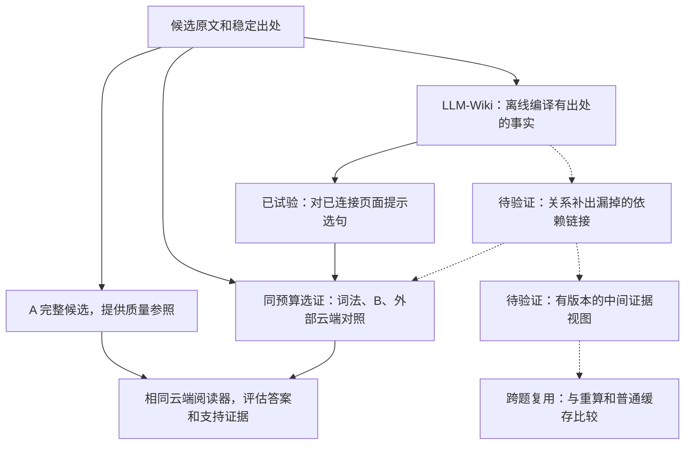

# 同预算外部压缩对照与研究脉络

*2026-11-10 · 固定候选池 · 百炼云端推理*

## 实验协议

沿用三档预算实验冻结的 HotpotQA 和 MuSiQue 官方 dev 子集，每套 100 道、100 个题族。原样复用 A、独立句选和 B 依赖装配的证据文本，重新用同一固定答题模型、提示和设置生成答案。同一道题的证据文本相同就共享真实响应。题集以前已用于三档比较，本轮是对齐条件下增加对照。选证时只读问题、候选标题和原句，官方答案和支持标注只用于离线评分。

| 条件 | 选证方式 |
|---|---|
| A | 原序完整候选 |
| B 关 | 独立词法句选 |
| B 开 | 标题消歧、按问题属性补跨页证据 |
| 语义重排抽取 | 百炼 `qwen3-rerank` 对带标题的所有候选原句打分，按排名逐句装入 |
| LLM 直接抽取 | 百炼 `qwen3.5-plus-2026-04-20` 一次查看题目及所有候选原句，输出句子编号顺序，装配器只取原文 |

两种外部对照均对整组候选一次排序，再共享到 512、1,024、2,048 三个证据预算。渲染以相同的原标题、原句顺序输出，按同一个冻结 Qwen tokenizer 核算实际装入长度。预算约束的是阅读器收到的证据，上游排序开销另计。阅读器固定为百炼北京 `qwen3.5-plus-2026-04-20`，温度 0、非思考、最多 128 个输出 token。`qwen3-rerank` 是服务模型标识，API 未提供独立快照版本。

现有百炼接口找不到可直接调用的 Provence 或 LLMLingua-2 原版模型端点。两种实际对照是独立语义重排与直接 LLM 选证。直接选证的思路可对照 SPARE-RAG 的 Direct LLM，句级粒度、模型及装配策略有差异。Context7 的查询结果未覆盖所需接口，已对照百炼官方参数与真实调用。[百炼重排接口](https://help.aliyun.com/zh/model-studio/text-rerank-api) · [结构化输出](https://help.aliyun.com/zh/model-studio/qwen-structured-output) · [SPARE-RAG §5.2](https://doi.org/10.3390/info17101052) · [Provence 权重](https://huggingface.co/naver/provence-reranker-debertav3-v1) · [LLMLingua-2 权重](https://huggingface.co/microsoft/llmlingua-2-bert-base-multilingual-cased-meetingbank)

第一遍直接抽取只在提示中要求返回 JSON，出现自由文本、超长和空数组。随后为全部 200 道题开启 API `json_object`，以同一规则重跑直接抽取。若返回非空但缺部分编号，保留模型排序，再按原始顺序把漏掉的编号放到队尾，另记哪些实际入模。旧格式日志保留，其他组复用第一遍的已测结果，第二遍出现完全相同证据文本时共享第一遍对应回答。源文件、先前配置和预测的哈希随新配置落盘。

```powershell
# 第一遍使用归档在该运行目录 source 下的代码版本。
& .venv/Scripts/python.exe -X utf8 external_compression.py runs/cloud-external-compression-dev --workers 16
# 第二遍使用当前项目的 JSON 模式版本。
& .venv/Scripts/python.exe -X utf8 external_compression.py runs/cloud-external-compression-dev-json --revise-listwise runs/cloud-external-compression-dev --workers 16
```

## 答案与证据结果

表内为所有条件共同成功题的答案 F1。HotpotQA 100 题，MuSiQue 99 题。第一遍直接抽取 32 题未返回可用 JSON。第二遍只有 1 道 MuSiQue 返回空数组，三个预算都记为失败，并从配对表全部条件统一排除。200 个语义重排请求均成功。在第二遍直接抽取的 199 个有效排名中，29 个漏过编号，20 道题至少有一档实际用到队尾补入的句子。

| 数据集 | 证据预算 | A 完整候选 | B 关 | B 开 | 语义重排抽取 | LLM 直接抽取 |
|---|---:|---:|---:|---:|---:|---:|
| HotpotQA | 512 | 78.90% | 67.64% | 71.39% | 81.10% | 80.40% |
| HotpotQA | 1,024 | 78.90% | 77.27% | 79.27% | 80.36% | 80.33% |
| HotpotQA | 2,048 | 78.90% | 78.90% | 78.90% | 78.90% | 78.90% |
| MuSiQue | 512 | 70.34% | 39.00% | 48.27% | 69.25% | 72.23% |
| MuSiQue | 1,024 | 70.34% | 43.82% | 52.26% | 67.52% | 73.36% |
| MuSiQue | 2,048 | 70.34% | 62.98% | 65.00% | 70.48% | 69.45% |

MuSiQue 512 档，语义重排比 B 开高 **20.98** 个 F1 百分点，配对 95% bootstrap 区间 **[+11.26, +30.52]**。1,024 档高 **15.26** 点，区间 **[+7.21, +23.59]**。HotpotQA 512 档高 **9.71** 点，区间 **[+4.69, +15.40]**。MuSiQue 2,048 档及 HotpotQA 1,024 档的重排相对 B 开区间均跨零。HotpotQA 2,048 档每种压缩方法都有 98 道与 A 的证据文本相同。直接抽取在 MuSiQue 两档紧预算得分最高，表内未做它与语义重排之间的显著性判断。

固定 512 档时，HotpotQA 完整参考句保留从 B 开 **60/100** 增至语义重排 **91/100**。MuSiQue 的全部参考段落至少触达一句，从 **40/99** 增至 **83/99**，直接抽取为 **89/99**。要求全部参考段落全文时三者分别为 **1/99、21/99、14/99**。段落触达衡量跨度覆盖，无法确认该句正好是必要证据。[共同样本结果与区间](../runs/cloud-external-compression-dev-json/comparison.json) · [逐题答案与证据](../runs/cloud-external-compression-dev-json/scored.jsonl) · [校验记录](../runs/cloud-external-compression-dev-json/verification.txt)

- **HotpotQA `5a78f59755429970f5fffdf7`。** 512 档的 B 已找到 Mick Carter 是 The Queen Victoria 的房东，也保留了酒吧页首句，但漏了下一句的地址。重排保留三条参考句，答对 `46 Albert Square, Walford, London E20`。这是找到页面后没有取到所问属性的例子。
- **MuSiQue `2hop__132469_533882`。** 512 档的 B 保留了 AAM-N-4 Oriole 由 Glenn L. Martin Company 开发的原句，却没保留 Martin Marietta 页的合并事实。重排保住两页并答对 `Martin Marietta`。这是仅靠候选标题难以连上组织继承关系的例子。

## 用量与时间

两遍各有 2,600 条问答条件。第一遍发出 1,574 次独立阅读请求、200 次语义重排和 200 次直接抽取。第二遍统一新增 200 次结构化抽取，另有 254 次阅读请求用于新增证据文本。按 API 返回用量及标价折算，两遍合计约 **3.34 元**。共享响应只计一次。[首轮运行](../runs/cloud-external-compression-dev/comparison.json) · [第二轮运行](../runs/cloud-external-compression-dev-json/comparison.json)

同样是 MuSiQue 512 档，三种压缩方法的证据中位长度在 **509–510 token**。按每题一次排序加一次阅读单独计费，平均标价约为 B **0.00049 元**、语义重排 **0.00300 元**、直接抽取 **0.00427 元**，A **0.00202 元**。计算用阅读输入和输出 token 的单价，加上对应排序调用的用量价。语义重排和直接抽取的选证 API 计时中位数分别约 **0.61 秒、5.37 秒**，是并发实验的单阶段记录。尚未用统一请求顺序和缓存条件做端到端延迟实验。读入证据更少并不保证整条链路更省。[逐题排序及用量](../runs/cloud-external-compression-dev-json/rankings.jsonl) · [百炼价格](https://help.aliyun.com/zh/model-studio/model-pricing)

## 研究脉络



1. **质量线。** 在相同预算下，B 的开关消融隔离了规则依赖装配的作用。此前 MuSiQue 紧预算有收益，独立保留题的 2,560 档接近 A，但仅节省 6.17% API 输入。本轮确认语义排序在同样的紧预算下可以保住更多证据，现有 B 的收益仍停留在相对独立词法句选。
2. **Wiki 的作用。** 编译与装配是两步。已有 20 道新题验证的只是让编译索引给已连接页面提示选句，最终仅改变一道输入，F1 持平。下一步固定强语义重排为底座，测同一底座上新增的有出处依赖链接是否提高必要证据召回，先分辨「找到目标页却取错句」和「实体关系根本没连上」。
3. **数据库的作用。** SQLite 已记录来源、版本、原句和索引关系。跨题复用要测的对象是有依据的中间事实证据包。用答案不同但共享中间事实的自然题，与在线重算、普通缓存比较有效命中、装配 P50/P95、端到端时间和维护成本。这个阶段尚无实测加速结论。

项目当前的研究假设是，在强相关性排序上添加**可追溯、可成组保留、可跨题复用**的中间证据，有机会在固定预算或固定质量下改善证据与查询成本。三个效果分别验收。[三档预算](证据替换审计与三档预算结果.md) · [2,560 独立验证](直接证据保护与自适应预算验证.md) · [Wiki 编译保留题](LLM-Wiki主体校验与保留题对照.md) · [复用工作负载](LLM-Wiki载体与查询负载决策.md)

下一轮在未用问题族上冻结三组 `语义重排`、`语义重排＋规则桥接`、`语义重排＋有出处的编译关系`，优先跑 512 和 1,024 档。逐题记录补回和挤出的原句，分别估计证据和答案增益。若识别到在不同问题上稳定有效的中间事实，再固定该选证策略，单独比较物化复用和普通缓存。Provence 与 LLMLingua-2 仍需可用的原版权重云端端点才能实跑。
